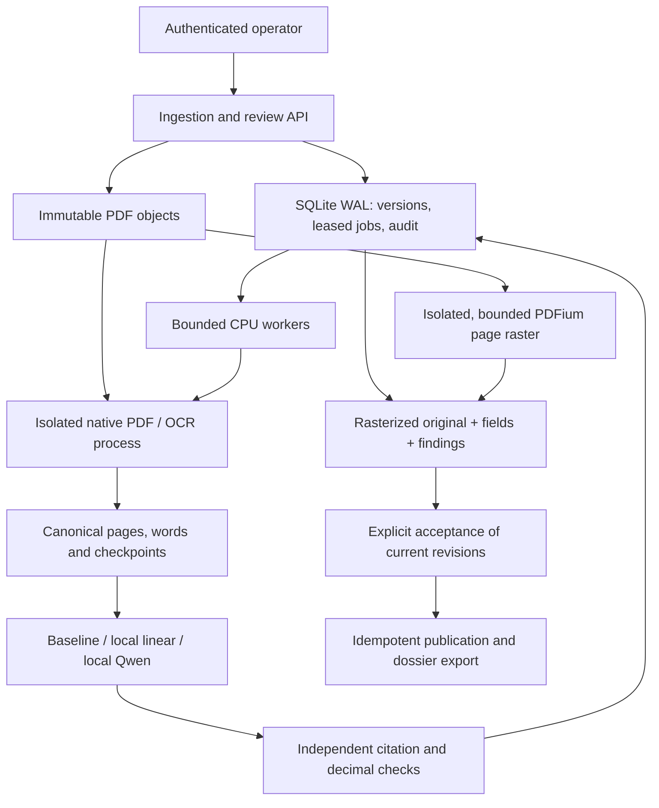

# Architecture and trust boundaries

## Product flow

The reference is a bounded, single-host purchasing-control application. A dossier
contains one purchase order and its delivery notes and invoices. Uploading or
viewing a document never accepts it. The same dossier can have successive explicit
publications; downstream consumers upsert by case ID and follow the supersession
link, rather than treating each publication as another payment instruction.

## Persistence and queue

PDF objects are addressed by SHA-256 and written using an atomic link, without
overwriting existing bytes. A stable document key identifies a business piece;
different bytes create a new version. Reposting identical bytes under the same key
returns the existing ID. A different key cannot disguise identical content inside
the same case. Publishing the same supplier/invoice identity in another case is
blocked transactionally.

SQLite stores document versions, extraction revisions, page checkpoints, queue
attempts, human decisions and publications. WAL supports concurrent readers and
short serialized writes on one host. It is not a distributed database and must
not be placed on NFS/SMB. API admission and job claiming use `BEGIN IMMEDIATE`.
Original-byte and evidence checks run before acceptance/publication.

Each running job owns a random lease token. Checkpoints, final results and failures
are committed only while that token still owns an unexpired lease. New document
versions and cancellation revoke the token. An old worker cannot overwrite a new
attempt. Expired work returns to the queue up to the attempt budget; restoring a
snapshot does not create another automatic retry allowance. Manual retry requires
an operator and reason, records the previous budget/policy, and starts a new cycle.

Small documents receive preference until a queued item has waited 60 seconds;
aged items move ahead to prevent starvation. The global active-job cap is checked
inside the claim transaction, across all worker processes. `batch_size` limits
sequential claims per worker loop; it is not GPU tensor batching. Native/OCR
processes remain separate from the optional single-slot model server.

## Parser boundary

The API checks byte and PDF signature limits without invoking a parser. A child
process applies address-space, CPU, file-size and open-file limits before loading
the PDF. Linux libseccomp denies network socket syscalls and is inherited by OCR.
The parent enforces a wall deadline and terminates the process group. Missing
libseccomp or an unsupported host fails closed. Docker adds a networkless worker,
read-only image, limited temporary storage, dropped capabilities and quotas.

PDF actions, scripts, attached files, encryption and malformed documents are
rejected. Native words are used for ordinary pages. Scanned/image-heavy pages use
PDFium rasterization and the actual Tesseract LSTM OCR engine, including pages with
a dense hidden native text layer. PDFium stays in separate processes, not shared
threads. Page-level checkpoints bind the document hash and exact parser/OCR
versions, including trained-data digest. Resume revalidates budgets and runtime
identity before reuse.

PDF parsers are not document-authenticity verifiers. Pure-native invisible/white
text, sophisticated visual deception, layout semantics outside the contract and
forged supplier documents still require human review. A digest verifies content
agreement; it does not establish authenticity or certification.

## Authenticated original-page rendering

The review UI retains the original PDF download as SHA-256-addressed immutable
bytes. Instead of relying on a browser's native PDF plugin inside a sandboxed
iframe, `GET /api/documents/{id}/preview/{page}` returns an authenticated
PNG raster of exactly one inspected page. It does not change the document
extraction, source citation or acceptance policy.

Rasterization starts a separate Linux PDFium process **after** applying the
same seccomp policy as the parser. The process revalidates the original SHA-256
and disallowed PDF actions/encryption, enforces the configured document/page
limits, restricts CPU and virtual memory, denies network syscalls and has a
12-second maximum preview deadline. Pixels are capped at 2.5 million, PNG
at 5 MiB, and the API limits preview work to two concurrent child jobs per API
process (rejecting additional work with `429 PREVIEW_BUSY`). The parent
verifies the child result, PNG dimensions and raster SHA-256. No raw PDF engine
is loaded into the API process and no third-party rendering service is called.

The browser fetches the PNG with its existing bearer token, uses a temporary
`blob:` URL, and displays the image with page controls. Navigating to an
evidence quote loads that source page, while PDF downloads remain the exact
original bytes. Switching documents or identities revokes object URLs and
fences late responses by session, document selection and revision. A failed
preview is explicitly shown as unavailable rather than fabricated as evidence.

Actual Chromium tests now assert image decode with nonzero natural width and
height, verify the authenticated PNG signature and preserve genuine desktop
and mobile screenshots. This is visual display evidence, **not** proof of
authenticity or independent human approval. The earlier native iframe produced
a broken icon and remains recorded in [issue #11](https://github.com/mehdisafer/document-control-intelligence/issues/11)
and older CI artifacts.

## Extraction and model routing

All three profiles share the independent evidence and business-rule boundary:

| Profile | Execution | Role |
|---|---|---|
| `baseline` | Deterministic headings, labels and table parsing | Reproducible non-LLM comparator |
| `local-linear` | Trained document and field-label classifiers, JSON weights | CPU local model; not an LLM |
| `local-llm` | Pinned Qwen GGUF through pinned llama.cpp | Experimental structured source selection |

The statistical model is trained on real parsed training PDFs. Its artifact is
bounded JSON containing vocabulary and numeric weights, with no pickle/callable
loading. Runtime calculations are checked against scikit-learn fitted outputs.

The LLM proposes typed source candidate IDs and a document class. It cannot supply
code, tool calls, provider URLs, raw filesystem paths, approval decisions or trusted
normalizations. The application resolves source coordinates and validates label,
column, raw value and transformations independently. The router checks fixed
loopback host, allowlisted model, weight digest, runtime binary/build, live loaded
model path, request size, output length, deadline and zero external-API budget.
No cloud provider is implemented or authorized, and no fallback changes profiles.

Unavailable inference is retried within the queue budget, then held for review.
Invalid artifacts/configuration and exceeded content budgets are terminal review
events. Malformed or unsupported individual values abstain. OCR confidence has a
conservative operational threshold; neither OCR confidence nor model probability
is a calibrated guarantee of correctness.

## Evidence and values

`contracts/` and generated JSON schemas define the wire contracts. Text offsets
are Unicode code-point offsets in canonical page text, start inclusive/end
exclusive. Boxes are PDF points with a top-left origin. OCR pixels are scaled back
to this coordinate system. A field carries raw and normalized values, evidence,
transformation history, status and origin. Calculations remain in check results.

Human corrections never rewrite parsed text or original bytes. They preserve
the earlier field, new field, reason, authenticated actor, timestamp, document
version and extraction revision. A corrected value is explicitly human, even if
it differs from the printed source; the old quotation is retained for audit and
does not pretend to support the new value. The correction must survive arithmetic
and reconciliation checks, and a different actor must accept the dossier.

## Review, publication and authorization

Every configured actor can read. `operator` creates dossiers/uploads, corrects,
cancels and retries. `approver` accepts a specific current revision and cannot
self-approve their corrections. `publisher` publishes that accepted fingerprint.
Actors may be assigned multiple roles, but the correction self-approval rule still
applies. An operator can also review an unknown or incorrect document type. The
immutable processing event preserves the original model class/score; a separate
`classification.reviewed` event records the old/new type, actor, reason and source
revision. Acceptance verifies this provenance before using the human type decision.
Only that verified human context can waive the model-score threshold; it never
bypasses source/financial checks or turns `unknown` into an accepted type. Model
confidence is preserved, not replaced with a fabricated score of 1.

Tokens are external, high-entropy bearer credentials; only SHA-256 values
are in the authentication configuration. Production identity federation is outside
this single-team reference and is an explicit backlog item.

Any upload, processing result, correction or retry invalidates previous acceptance
and the current-publication marker. Prior exports remain immutable history. A
unique `(case_id, fingerprint)` prevents duplicate publication. The exported JSON
contains original references, normalized fields, checks, reconciliation and audit;
the ZIP additionally contains actual source PDFs and a content manifest.

ZIP export limits the combined **uncompressed member bytes** to 50 MiB: the
UTF-8 dossier JSON, every original PDF and the manifest JSON share one counter.
JSON encoding and original copying are incremental; an over-budget request
returns `413 EXPORT_BUDGET`, and a changed original returns
`503 BLOB_INTEGRITY`. This is not an RSS or final compressed ZIP-size limit; the
application has already loaded the dossier and the archive has framing overhead.

The UI binds asynchronous results to the actor session and current selection.
Late metadata, original-PDF, page-raster and audit responses cannot replace a newer view.
Case refreshes also invalidate a pending document fetch when its revision or
processing status advances. The field-correction control requires a selected current field;
decision dialogs retain the IDs and revisions reviewed when opened. Cancelling
a dialog prevents a late response from changing the current UI, but cannot undo
a mutation already sent. Server-side role and revision checks remain authoritative.

## Boundaries of the reference

Supported inputs are PDF only, including scans embedded in PDF. The schema covers
positive purchase lines in EUR/USD/GBP/CHF. Credit notes, returns, discounts,
freight, foreign-exchange conversion, several POs per dossier and repeated SKU
lines requiring separate line identity are not automatically accepted. The final
benchmark and acceptance matrix identify further observed limits.

No personal workstation, customer environment or other portfolio repository is
used by this implementation. Container definitions and Terraform create only
single-host Docker resources; no cloud account, cluster or public endpoint is
implicitly provisioned.
